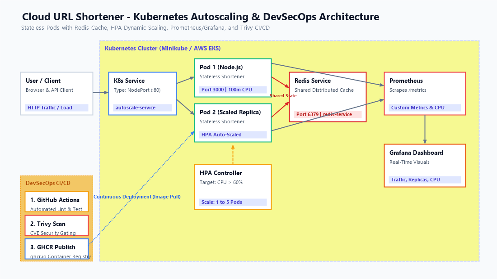
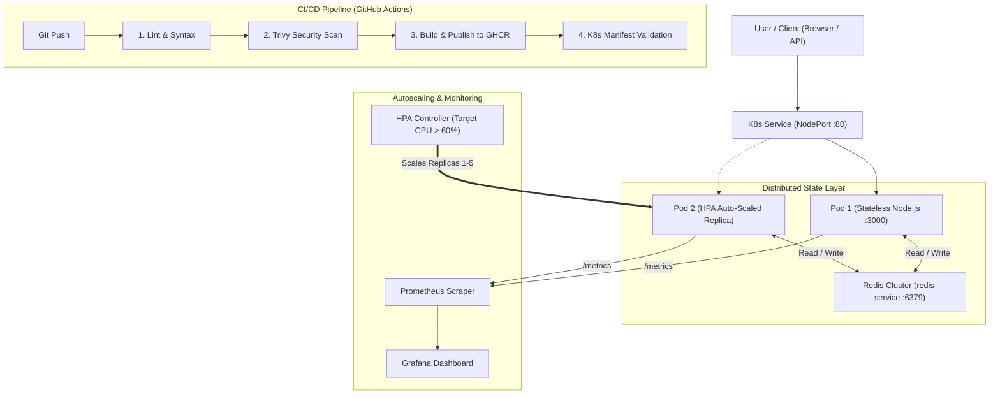

# 🚀 Cloud-Native URL Shortener with Kubernetes Autoscaling & DevSecOps

[](https://github.com/chlokeshoct2006/cloud-autoscaling-urlshortner-webapp/actions/workflows/ci-cd.yaml)
[](https://opensource.org/licenses/MIT)
[](https://www.docker.com/)
[](https://kubernetes.io/)
[](https://trivy.dev/)

A production-grade, cloud-native URL Shortener application demonstrating modern DevOps and Cloud architecture:

- ⚡ **Kubernetes Horizontal Pod Autoscaler (HPA)** for dynamic replica scaling based on CPU utilization
- 🗄️ **Stateless Microservice Architecture** backed by a **Redis distributed cache** for multi-pod consistency
- 🛡️ **DevSecOps CI/CD Pipeline** using GitHub Actions with **Trivy container security scanning** and automated publishing to **GHCR (GitHub Container Registry)**
- 📊 **Prometheus & Grafana Monitoring** with custom application metrics (`prom-client`)
- 🐳 **Docker Multi-Layer Containerization** and **Docker Compose** local stack

---

## 🏗 Architecture



### System Flow


---

## 🧰 Tech Stack

- **Application**: Node.js, Express.js, Crypto, HTML5/CSS3/JavaScript
- **Caching & State**: Redis (via `ioredis`), In-Memory fallback
- **Containerization**: Docker, Docker Compose
- **Orchestration**: Kubernetes (Deployments, Services, HPA) on Minikube / AWS EKS
- **DevSecOps & CI/CD**: GitHub Actions, Trivy (Aqua Security), GHCR
- **Observability**: Prometheus, Grafana, `prom-client`

---

## 📡 API Endpoints

| Method | Endpoint | Description |
| :--- | :--- | :--- |
| `GET` | `/` | Web frontend UI |
| `GET` | `/health` | Kubernetes Liveness & Readiness probe (returns status & storage engine) |
| `GET` | `/metrics` | Prometheus metrics scrape endpoint |
| `POST` | `/shorten` | Shortens a URL (JSON body: `{"url": "https://..."}`) |
| `GET` | `/:code` | Redirects short URL to destination |
| `GET` | `/stats/all` | Returns stats on all URLs, storage backend (Redis/Memory), and serving pod |
| `GET` | `/load` | CPU-intensive calculation simulating traffic spikes to trigger HPA |

---

## 🚀 Running the Project

### 1. Local Development (Node.js)
```bash
cd app
npm install
npm start
```
*App will start on `http://localhost:3000` (defaults to memory store if Redis is absent).*

### 2. Full Local Stack with Docker Compose (App + Redis + Prometheus)
```bash
docker-compose up --build
```
- App UI: `http://localhost:3000`
- Prometheus: `http://localhost:9090`
- Redis: `localhost:6379`

### 3. Deploying to Kubernetes (Minikube / EKS)
```bash
# 1. Deploy Redis service
kubectl apply -f k8s/redis.yaml

# 2. Deploy URL shortener app & NodePort service
kubectl apply -f k8s/deployment.yaml
kubectl apply -f k8s/service.yaml

# 3. Enable Horizontal Pod Autoscaler
kubectl apply -f k8s/hpa.yaml
```

---

## ⚡ Testing Autoscaling (HPA)

1. Enable `metrics-server` on your cluster:
   ```bash
   minikube addons enable metrics-server
   ```
2. Watch HPA status:
   ```bash
   kubectl get hpa autoscale-hpa --watch
   ```
3. Generate load via the UI button or terminal:
   ```bash
   while true; do curl -s http://<SERVICE_IP>/load > /dev/null; done
   ```
4. As CPU exceeds 60%, HPA will dynamically spin up new pods (1 ➔ 2 ➔ up to 5 replicas). Because **Redis** stores all URLs, any pod can handle redirects seamlessly!

---

## 🎓 Placement & Interview Cheatsheet

### Q1: Why use Redis when pods already run the application?
> **Answer**: In a Kubernetes cluster with autoscaling, traffic is load-balanced across multiple pod replicas. If state is kept in pod memory, Pod A will not know about URLs created by Pod B. By externalizing state to Redis, our Node.js microservices remain completely **stateless**, enabling true horizontal scaling without data fragmentation.

### Q2: How does Kubernetes HPA work under the hood?
> **Answer**: The Horizontal Pod Autoscaler queries the Kubernetes Metrics API (provided by `metrics-server`) periodically (every 15s). It evaluates `desiredReplicas = ceil[currentReplicas * (currentMetric / targetMetric)]`. When average CPU crosses 60%, HPA issues an update to the Deployment controller to increase pod replicas.

### Q3: What is the DevSecOps strategy in this project?
> **Answer**: We integrated **Trivy** directly into our GitHub Actions pipeline to scan the container image layers for CVEs (Common Vulnerabilities and Exposures) with High and Critical severities before publishing the container to GHCR, enforcing automated security gating before deployment.

---

## 📄 License
This project is open-source under the [MIT License](LICENSE).
