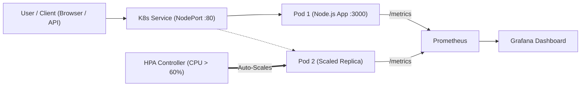

# 🚀 Cloud URL Shortener with Kubernetes Autoscaling

A production-style, cloud-native URL Shortener web application designed to demonstrate cloud architecture best practices:

- ⚡ **Kubernetes Horizontal Pod Autoscaler (HPA)** for dynamic scaling based on real CPU load
- 📊 **Prometheus & Grafana Monitoring** for real-time observability and resource tracking
- 🐳 **Docker Containerization** with multi-layer optimization
- ☸️ **Kubernetes Orchestration** (Minikube / AWS EKS) with liveness & readiness health probes
- 🔄 **Automated CI/CD Pipeline** using GitHub Actions

---

## 🏗 Architecture


### Architecture Workflow


---

## 🧰 Tech Stack

- **Frontend**: HTML5, CSS3, JavaScript (Fetch API, responsive UI)
- **Backend**: Node.js, Express.js, Crypto
- **Containerization**: Docker
- **Orchestration**: Kubernetes (Deployments, Services, HPA)
- **Monitoring**: Prometheus, Grafana, `prom-client`
- **CI/CD**: GitHub Actions
- **Cloud / Cluster**: AWS EKS / Minikube

---

## 📡 API Endpoints

| Method | Endpoint | Description |
| :--- | :--- | :--- |
| `GET` | `/` | Web frontend UI |
| `GET` | `/health` | Kubernetes Liveness & Readiness health probe (returns `UP`) |
| `GET` | `/metrics` | Prometheus metrics scrape endpoint |
| `POST` | `/shorten` | Shortens a URL (JSON body: `{"url": "https://..."}`) |
| `GET` | `/:code` | Redirects short URL to original destination |
| `GET` | `/stats/all` | Returns statistics on all shortened links and current pod name |
| `GET` | `/load` | CPU-intensive computation simulating high traffic to test HPA |

---

## 🚀 Getting Started

### 1. Run Locally (Node.js)

```bash
# Navigate to the app directory
cd app

# Install dependencies
npm install

# Start the application
npm start
```
The application will run at `http://localhost:3000`.

---

### 2. Run with Docker

```bash
# Build Docker image
docker build -t autoscale-app -f docker/Dockerfile .

# Run Docker container
docker run -d -p 3000:3000 --name autoscale-app autoscale-app
```

Or run the full stack with **Docker Compose** (including Prometheus):
```bash
docker-compose up --build
```
- Web Application: `http://localhost:3000`
- Prometheus Server: `http://localhost:9090`

---

## ☸️ Deploying to Kubernetes

### 1. Apply Kubernetes Manifests

```bash
# Deploy application pods
kubectl apply -f k8s/deployment.yaml

# Expose through Service
kubectl apply -f k8s/service.yaml

# Enable Horizontal Pod Autoscaler
kubectl apply -f k8s/hpa.yaml
```

### 2. Verify Deployment

```bash
kubectl get pods -l app=autoscale
kubectl get svc autoscale-service
kubectl get hpa autoscale-hpa
```

If using **Minikube**, get the service URL:
```bash
minikube service autoscale-service
```

---

## ⚡ Testing Auto-Scaling (HPA)

1. Make sure `metrics-server` is enabled in your cluster:
   ```bash
   minikube addons enable metrics-server
   ```
2. Monitor HPA in real time:
   ```bash
   kubectl get hpa autoscale-hpa --watch
   ```
3. Generate load using the built-in UI button or via terminal:
   ```bash
   # Run a continuous load generator loop
   while true; do curl -s http://<SERVICE_IP>/load > /dev/null; done
   ```
4. Observe the CPU utilization cross **60%**, triggering HPA to automatically scale up pods from 1 to 2+ replicas! Once the load ceases, HPA smoothly scales back down to `minReplicas`.

---

## 📊 Prometheus & Grafana Monitoring

Detailed setup instructions and PromQL queries are provided in [`monitoring/prometheus-grafana.md`](monitoring/prometheus-grafana.md).

---

## 📄 License

This project is open-source and available under the [MIT License](LICENSE).
